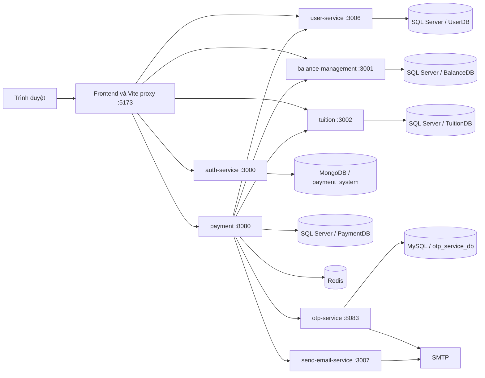
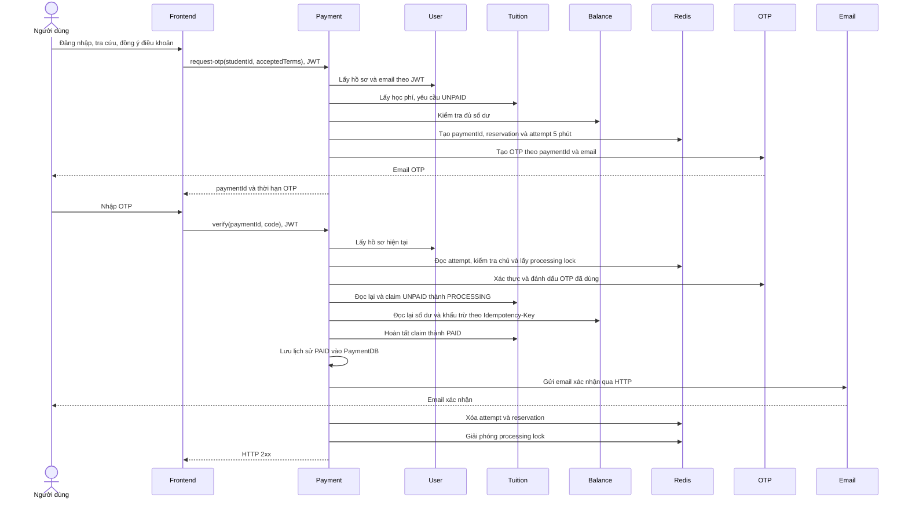

- nhóm: SOA.26-20.
- Repository: [PeterKhang3012/Payment-system](https://github.com/PeterKhang3012/Payment-system).
# KDNPay – Payment System

KDNPay là hệ thống thanh toán học phí đại học theo kiến trúc microservices. Người dùng đăng nhập, xem hồ sơ và số dư ví, tra cứu học phí theo mã sinh viên, xác nhận bằng OTP qua email và xem lịch sử thanh toán. Dự án minh họa việc phối hợp nhiều dịch vụ và cơ sở dữ liệu trong một quy trình thanh toán, có kiểm tra đồng thời và chống khấu trừ trùng.

## Mục lục

- [1. Tổng quan và chức năng](#1-tổng-quan-và-chức-năng)
- [2. Kiến trúc hệ thống](#2-kiến-trúc-hệ-thống)
- [3. Công nghệ sử dụng](#3-công-nghệ-sử-dụng)
- [4. Cấu trúc dự án](#4-cấu-trúc-dự-án)
- [5. Yêu cầu môi trường](#5-yêu-cầu-môi-trường)
- [6. Cài đặt và cấu hình](#6-cài-đặt-và-cấu-hình)
- [7. Chạy ứng dụng](#7-chạy-ứng-dụng)
- [8. Địa chỉ truy cập](#8-địa-chỉ-truy-cập)
- [9. Tài liệu API](#9-tài-liệu-api)
- [10. Quy trình thanh toán](#10-quy-trình-thanh-toán)
- [11. Khắc phục sự cố](#11-khắc-phục-sự-cố)
- [12. Lưu ý bảo mật](#12-lưu-ý-bảo-mật)
- [13. Hướng phát triển](#13-hướng-phát-triển)
- [14. Tác giả](#14-tác-giả)

## 1. Tổng quan và chức năng

| Chức năng | Implementation hiện tại |
|---|---|
| Đăng nhập | Username/password, đối chiếu bcrypt trong MongoDB, phát hành JWT RS256 |
| Hồ sơ người dùng | Đọc họ tên, email, số điện thoại và ngày tạo của tài khoản đang đăng nhập |
| Ví | Xem số dư; backend khấu trừ toàn bộ học phí trong quy trình thanh toán |
| Tra cứu học phí | Nhập mã sinh viên dạng số để lấy tên sinh viên, số tiền và trạng thái |
| Thanh toán học phí | Kiểm tra điều khoản, học phí và số dư; xác thực OTP trước khi khấu trừ |
| OTP qua email | Mã 6 chữ số, gắn với `paymentId`, có thời hạn và xác thực dùng một lần |
| Lịch sử giao dịch | Lấy các giao dịch của người dùng hiện tại; giao dịch được ghi với trạng thái `PAID` |
| Email xác nhận | Gửi email HTML sau khi cập nhật học phí và lưu giao dịch |
| Kiểm soát đồng thời | Redis reservation/lock, khóa bi quan tại database và claim học phí có điều kiện |
| Chống khấu trừ trùng | Lưu kết quả khấu trừ theo `paymentId`, nhận qua header `Idempotency-Key` |

## 2. Kiến trúc hệ thống

Các backend giao tiếp đồng bộ bằng HTTP. Payment service dùng Spring `RestClient` để điều phối, chuyển tiếp Bearer token đến user, balance và tuition; OTP và email dùng header nội bộ. Không có message broker hoặc API gateway backend độc lập.



| Service trong Compose | Thư mục | Trách nhiệm |
|---|---|---|
| `auth-service` | `Backend/auth-service` | Đối chiếu tài khoản và ký JWT bằng private RSA key |
| `user-service` | `Backend/User` | Tra cứu hồ sơ theo claim `userId` |
| `balance-management` | `Backend/balance-management` | Đọc ví, khóa bản ghi và khấu trừ có idempotency |
| `tuition` | `Backend/tuition-management` | Tra cứu, claim, hoàn tất hoặc giải phóng học phí |
| `payment` | `Backend/payment-service` | Quản lý attempt trong Redis, điều phối OTP và thanh toán, lưu lịch sử |
| `otp-service` | `Backend/otp-service` | Sinh OTP, lưu MySQL, gửi email và xác thực OTP |
| `send-email-service` | `Backend/email-notification-service` | Nhận yêu cầu nội bộ và gửi email xác nhận thanh toán |

Tên service Compose khác một số tên container: `payment` có container `payment-service`, `tuition` có container `tuition-management`, `send-email-service` có container `email-notification-service`. Lệnh `docker compose logs` sử dụng tên service.

Trong Docker, frontend gọi `/gateway/auth`, `/gateway/user`, `/gateway/balance`, `/gateway/tuition`, `/gateway/payment`. Vite bỏ tiền tố tương ứng và chuyển request tới backend trong mạng `payment-network`. Đây là proxy phát triển; bản build tĩnh cần cấu hình reverse proxy và SPA fallback riêng.

## 3. Công nghệ sử dụng

| Nhóm | Công nghệ được khai báo/sử dụng |
|---|---|
| Frontend | React 19, TypeScript 5.9, Vite 6.4, React Router 7, Axios, Lucide React, CSS |
| Backend xác thực | Node.js, Express 5, Mongoose 9, bcryptjs, jsonwebtoken, dotenv |
| Backend Java | Java 21, Spring Boot, Spring MVC, Bean Validation, Spring Data JPA/Hibernate, Lombok |
| Phiên bản Spring Boot | 4.1.1 cho User/balance/tuition/payment; 4.1.2 cho email; 3.2.5 cho OTP |
| Bảo mật | JWT RS256, Spring Security OAuth2 Resource Server, RSA key, token nội bộ |
| Database | MongoDB 8, SQL Server 2022 Developer, MySQL 8 |
| Dữ liệu tạm và lock | Redis 8, Spring Data Redis |
| OTP và email | SecureRandom, Spring Mail/JavaMailSender, SMTP STARTTLS |
| API documentation | springdoc OpenAPI trong OTP và User; cần lưu ý giới hạn truy cập/tương thích bên dưới |
| Hạ tầng | Dockerfile nhiều giai đoạn cho Java, Docker Compose, Maven/Maven Wrapper, npm |

Các phiên bản trên lấy từ manifest và Dockerfile, không phải cam kết đã kiểm thử tương thích toàn bộ stack.

## 4. Cấu trúc dự án

```text
Payment-system/
├── Backend/
│   ├── auth-service/                  # Express, MongoDB, JWT
│   ├── User/                          # Hồ sơ người dùng
│   ├── balance-management/            # Ví và khấu trừ
│   ├── tuition-management/            # Học phí và claim
│   ├── payment-service/               # Điều phối, Redis, lịch sử
│   ├── otp-service/                   # OTP, MySQL, SMTP
│   └── email-notification-service/    # Email xác nhận HTML
├── frontend/
│   ├── src/
│   │   ├── api.ts                     # Axios và DTO frontend
│   │   ├── main.tsx                   # Router, trang và trạng thái đăng nhập
│   │   ├── otpTiming.ts               # Tính thời hạn OTP
│   │   └── styles.css
│   ├── tests/
│   ├── package.json
│   ├── vite.config.ts
│   └── dockerfile
├── seed/
│   ├── mongo/01_init_auth.js
│   ├── mysql/init.sql
│   └── sqlServer/                     # Tạo database, bảng và dữ liệu mẫu
├── keys/                             # RSA key sinh khi chạy, bị Git bỏ qua
├── .env.example
├── .gitignore
├── docker-compose.yml
└── README.md
```

Mỗi service Java chứa `pom.xml`, `Dockerfile`, `src/main/java`, `src/main/resources` và `src/test`. OTP dùng Maven trong Docker build; các service Java còn lại có Maven Wrapper.

## 5. Yêu cầu môi trường

### Chạy toàn bộ bằng Docker

- Git để clone repository.
- Docker Desktop hoặc Docker Engine chạy Linux containers, kèm Docker Compose hỗ trợ `docker compose` và điều kiện `depends_on`.
- Kết nối mạng để tải image, dependency Maven/npm và cài OpenSSL trong container tạo key.
- SMTP hoạt động và một địa chỉ nhận email mà bạn kiểm soát để thử OTP.
- Các cổng host trong phần [địa chỉ truy cập](#8-địa-chỉ-truy-cập) còn trống.

### Chạy service local

- Java JDK 21 cho backend Java; Maven Wrapper ở từng module hoặc Maven 3.9.x cho OTP (Dockerfile OTP dùng 3.9.11).
- Node.js và npm: frontend Dockerfile dùng Node 20, auth Dockerfile dùng Node 24 Alpine. Auth còn khai báo dependency `node` với range `^26.7.0`; không có một phiên bản Node thống nhất cho toàn repository.
- OpenSSL nếu tự tạo RSA key ngoài Docker.
- Database, Redis và SMTP vẫn cần hoạt động. Backend mặc định dùng hostname Docker; phải cấu hình hoặc cung cấp DNS phù hợp khi chạy trên host.

## 6. Cài đặt và cấu hình

### Bước 1: Clone repository

```sh
git clone https://github.com/PeterKhang3012/Payment-system.git
cd Payment-system
```

### Bước 2: Tạo biến môi trường

PowerShell, từ thư mục gốc:

```powershell
Copy-Item .env.example .env
```

Linux/macOS:

```sh
cp .env.example .env
```

Nếu đã có `.env`, chỉnh file hiện tại thay vì chép đè. Điền các giá trị riêng của môi trường; không commit file này.

| Nhóm | Biến | Yêu cầu và ý nghĩa |
|---|---|---|
| MySQL/OTP | `OTP_DB_USERNAME` | Template dùng `root`; Compose chỉ tự tạo tài khoản root, không tạo user tùy chỉnh |
| MySQL/OTP | `OTP_DB_PASSWORD` | Bắt buộc; dùng cho MySQL root và kết nối OTP |
| SQL Server | `SQLSERVER_USERNAME` | Template dùng `sa`; seed kết nối bằng `sa`, tài khoản khác phải được provision riêng |
| SQL Server | `SQLSERVER_PASSWORD` | Bắt buộc; mật khẩu SA đủ mạnh để SQL Server khởi động |
| Auth/MongoDB | `MONGO_URL` | Bắt buộc; với MongoDB trong Compose dùng `mongodb://mongodb:27017/payment_system` |
| RSA/auth | `JWT_PRIVATE_KEY_PATH` | Bắt buộc; trong Docker là `/app/keys/private.pem` |
| RSA/resource server | `JWT_PUBLIC_KEY_PATH` | Bắt buộc; trong Docker là `/app/keys/public.pem` |
| SMTP | `MAIL_HOST`, `MAIL_PORT` | Email service bắt buộc; template dùng `smtp.gmail.com`, `587` |
| SMTP | `MAIL_USERNAME`, `MAIL_PASSWORD` | Bắt buộc để gửi email; với Gmail dùng thông tin xác thực SMTP/App Password phù hợp |
| Email xác nhận | `MAIL_FROM` | Bắt buộc; địa chỉ gửi được SMTP cho phép |
| Nội bộ | `INTERNAL_SERVICE_TOKEN` | Bắt buộc cho OTP, payment và email; xem giới hạn token bên dưới |

Compose nội suy các biến `${...}` mà không khai báo giá trị mặc định. Giá trị mẫu trong `.env.example` cần được xem lại trước khi chạy. OTP có fallback `MAIL_HOST=smtp.gmail.com`, `MAIL_PORT=587` trong YAML, nhưng Compose hiện chỉ truyền `MAIL_USERNAME` và `MAIL_PASSWORD` vào OTP. Đổi host/port trong `.env` chỉ tác động email xác nhận theo Compose hiện tại; OTP vẫn dùng fallback nếu không được truyền thêm cấu hình.

Auth hỗ trợ `JWT_EXPIRES_IN` với mặc định `1h` trong mã nguồn, nhưng Compose chưa truyền biến này. Chỉ thêm biến vào `.env` gốc sẽ không tự đưa nó vào container.

**Điểm cần xử lý trước khi thử thanh toán:** `OtpClient.java` trong payment hiện gửi một token cố định trong source, không đọc `INTERNAL_SERVICE_TOKEN`. OTP service lại kiểm tra token từ biến môi trường. Vì vậy, chỉ điền `.env` chưa đảm bảo hai bên khớp nhau; developer cần thống nhất cách cấp token trước khi chạy luồng đầy đủ. Không sử dụng token cố định làm bí mật production. Tài liệu này không thay đổi implementation.

### Bước 3: Database và dữ liệu khởi tạo

| Thành phần | Cách khởi tạo |
|---|---|
| MongoDB | Mount `seed/mongo` vào `/docker-entrypoint-initdb.d`; tạo database `payment_system` và collection tài khoản khi data directory trống |
| SQL Server | `sqlserver-seed` chờ healthcheck rồi thực thi `/seed/*.sql`; tạo `UserDB`, `BalanceDB`, `TuitionDB`, `PaymentDB`, các bảng và dữ liệu mẫu |
| Bảng JPA SQL Server | Các service dùng `ddl-auto=update`; bảng giao dịch và dữ liệu idempotency được Hibernate quản lý |
| MySQL | Image tạo `otp_service_db`; OTP chạy `classpath:db/schema.sql` qua `spring.sql.init.mode=always`, với JPA `ddl-auto=none` |
| Redis | Khởi chạy trực tiếp, không có named volume hoặc cấu hình persistence riêng trong Compose |

`seed/mysql/init.sql` có trong repository nhưng không được Compose mount, vì vậy không phải script tự chạy của stack hiện tại. MongoDB chỉ chạy init script khi volume mới; SQL seed có kiểm tra tồn tại khi tạo database/bảng và chèn dữ liệu mẫu. Named volumes giữ dữ liệu MongoDB, MySQL và SQL Server qua lần dừng container thông thường.

**Kiểm tra đường dẫn trên hệ thống phân biệt chữ hoa/thường:** Compose mount `./seed/sqlserver`, nhưng thư mục được Git lưu là `seed/sqlServer`. Mount không đúng có thể khiến seed không chạy dù container seed kết thúc thành công. Developer cần thống nhất đường dẫn trước khi triển khai trên Linux; README không sửa Compose.

Tài khoản seed trong MongoDB được lưu bằng bcrypt hash; không có mật khẩu plaintext được xác minh từ script này. Nhờ người quản lý dự án cung cấp tài khoản thử nghiệm. Email OTP lấy từ `UserDB`, không lấy từ địa chỉ người dùng nhập trên frontend; cần chuẩn bị hồ sơ với email nhận được thư và giữ `userId` nhất quán giữa MongoDB, UserDB và BalanceDB. Mã học phí mẫu là số như `100001`, khác chuỗi `SV000001` trong bảng hồ sơ.

### Bước 4: RSA và xác thực

Service `key-generator` tự tạo cặp RSA 2048 bit vào `keys/private.pem`, `keys/public.pem` nếu thiếu một trong hai file. Nếu thiếu một file, script xóa cả hai file rồi tạo lại cặp mới. Các service cần key chờ job hoàn tất và mount thư mục này tại `/app/keys` ở chế độ chỉ đọc.

Có thể tạo thủ công bằng OpenSSL từ thư mục gốc, khi chưa có cặp key cần giữ:

```sh
mkdir keys
openssl genpkey -algorithm RSA -out keys/private.pem -pkeyopt rsa_keygen_bits:2048
openssl rsa -pubout -in keys/private.pem -out keys/public.pem
```

Bỏ qua `mkdir keys` nếu thư mục đã tồn tại. Auth ký token bằng private key. User, balance, tuition và payment xác thực chữ ký bằng public key. Token chứa `userId`, `username` và hết hạn theo cấu hình auth.

Các API này yêu cầu JWT và dùng claim `userId` để xác định tài khoản; kiểm tra ownership của payment attempt cũng dùng claim này. Chưa có phân quyền theo vai trò admin/user trong security configuration. API mutation của balance và tuition hiện yêu cầu JWT nhưng chưa có cơ chế riêng chỉ cho payment service gọi.

## 7. Chạy ứng dụng

### Toàn bộ bằng Docker Compose

Chạy tại thư mục chứa `docker-compose.yml`, sau khi hoàn tất các điều kiện cấu hình bên trên:

```sh
# Kiểm tra cú pháp và nội suy cấu hình, không in secret
docker compose config --quiet

# Build image
docker compose build

# Khởi động
docker compose up -d

# Xem trạng thái, bao gồm job đã kết thúc
docker compose ps -a

# Xem log toàn stack hoặc một nhóm service
docker compose logs -f
docker compose logs -f payment otp-service send-email-service

# Build lại và cập nhật container khi source thay đổi
docker compose up --build -d

# Dừng và gỡ container/network; giữ named volumes
docker compose down
```

`key-generator` và `sqlserver-seed` là job một lần, kết thúc với exit code 0 là bình thường. SQL Server và MySQL có healthcheck; nhiều dependency khác chỉ chờ `service_started`, chưa đảm bảo ứng dụng sẵn sàng nhận request. Payment chưa khai báo dependency trực tiếp vào user, balance, tuition và email.

Dockerfile Java dùng `-DskipTests`: build image thành công không có nghĩa các bài test đã chạy. Không dùng `docker compose down -v` trừ khi chủ động muốn xóa dữ liệu trong named volumes.

### Chạy frontend riêng trên host

Nếu backend chạy trong Docker, có thể dừng frontend container để giải phóng cổng 5173:

```sh
docker compose stop client
cd frontend
npm ci
```

Chạy trong PowerShell, đặt proxy target cho phiên terminal hiện tại:

```powershell
$env:AUTH_TARGET = 'http://localhost:3000'
$env:USER_TARGET = 'http://localhost:3006'
$env:BALANCE_TARGET = 'http://localhost:3001'
$env:TUITION_TARGET = 'http://localhost:3002'
$env:PAYMENT_TARGET = 'http://localhost:8080'
npm run dev
```

Trên shell POSIX:

```sh
AUTH_TARGET=http://localhost:3000 USER_TARGET=http://localhost:3006 BALANCE_TARGET=http://localhost:3001 TUITION_TARGET=http://localhost:3002 PAYMENT_TARGET=http://localhost:8080 npm run dev
```

Cấu hình Vite thực tế mặc định dùng hostname Docker, không phải localhost. Có thể lưu các URL proxy công khai trên vào `frontend/.env.local` khi tự cấu hình môi trường local. `api.ts` còn hỗ trợ `VITE_AUTH_URL`, `VITE_USER_URL`, `VITE_BALANCE_URL`, `VITE_TUITION_URL`, `VITE_PAYMENT_URL` để thay base URL khi build; không đặt secret trong các biến `VITE_*`.

Kiểm tra frontend theo scripts hiện có:

```sh
npm run typecheck
npm run lint
npm run build
```

### Chạy backend riêng trên host

Đây không phải cấu hình local hoàn chỉnh có sẵn. Cần dừng container tương ứng để tránh trùng port, cung cấp biến môi trường cho tiến trình và thay địa chỉ kết nối bằng runtime override khi có hỗ trợ:

- SQL Server trên host: `localhost:1434`, thay URL bằng `SPRING_DATASOURCE_URL` với đúng database của module.
- MySQL trên host: `localhost:3307/otp_service_db`; đặt `SPRING_DATASOURCE_USERNAME`, `SPRING_DATASOURCE_PASSWORD` hoặc các biến OTP tương ứng.
- Redis: `SPRING_DATA_REDIS_HOST=localhost`, `SPRING_DATA_REDIS_PORT=6379` cho payment.
- JWT: dùng đường dẫn tuyệt đối trên host cho `JWT_PUBLIC_KEY_PATH`/`JWT_PRIVATE_KEY_PATH`.
- Auth: `MONGO_URL=mongodb://localhost:27017/payment_system`.

Từ thư mục service Java có Wrapper, sau khi đã cấu hình môi trường:

```powershell
.\mvnw.cmd spring-boot:run
```

Linux/macOS dùng `./mvnw spring-boot:run`. Riêng OTP không có Wrapper trong repository, chạy `mvn spring-boot:run` tại `Backend/otp-service`.

Tại `Backend/auth-service`, cung cấp biến môi trường trước khi chạy:

```sh
npm ci
node app.js
```

Auth đọc private key khi import module, trước lời gọi `dotenv.config()` trong `app.js`; vì vậy nên truyền biến từ shell. Không dùng `npm run dev` của auth để khởi động server: script đó trỏ đến `scripts/generateKeys.js` không có trong thư mục service.

**Giới hạn chạy payment trên host:** Các client HTTP hiện hard-code hostname Docker (`user-service`, `balance-management`, `tuition-management`, `otp-service`, `email-notification-service`). Override database/Redis không thay các URL này. Nên chạy payment bằng Compose; chạy hoàn toàn local cần developer chuẩn bị phân giải tên/định tuyến tương ứng hoặc bổ sung cấu hình URL trong một thay đổi riêng.

## 8. Địa chỉ truy cập

| Thành phần | Địa chỉ trên host | Cổng trong container |
|---|---|---|
| Frontend | http://localhost:5173 | 5173 |
| Auth | http://localhost:3000 | 3000 |
| Balance | http://localhost:3001 | 3001 |
| Tuition | http://localhost:3002 | 3002 |
| User | http://localhost:3006 | 3006 |
| Email nội bộ | http://localhost:3007 | 3007 |
| Payment | http://localhost:8080 | 8080, mặc định Spring Boot |
| OTP nội bộ | http://localhost:8083 | 8083 |
| MongoDB | `localhost:27017` | 27017 |
| SQL Server | `localhost:1434` | 1433 |
| MySQL OTP | `localhost:3307` | 3306 |
| Redis | `localhost:6379` | 6379 |

Container dùng tên DNS nội bộ và cổng container; `localhost` trong container là chính container đó. Ví dụ backend kết nối SQL Server tại `sqlserver:1433`, không phải `localhost:1434`.

## 9. Tài liệu API

Các đường dẫn sau là đường dẫn backend trực tiếp, xác nhận từ controller/router. Thêm base URL ở bảng trên. Qua frontend proxy, thêm tiền tố gateway tương ứng, ví dụ `/gateway/user/api/users/me`.

| Service | Method | Endpoint | Mô tả và quyền truy cập |
|---|---|---|---|
| Auth | POST | `/login` | Username/password → JWT và thông tin tài khoản; không cần JWT |
| User | GET | `/api/users/me` | Hồ sơ hiện tại; Bearer JWT |
| Balance | GET | `/api/balances/me` | Số dư hiện tại; Bearer JWT |
| Balance | POST | `/api/balances/deduct` | Khấu trừ; Bearer JWT, `Idempotency-Key`, body là số JSON dương |
| Tuition | GET | `/api/tuitions/{studentId}` | Tra cứu theo mã sinh viên; Bearer JWT |
| Tuition | PUT | `/api/tuitions/{studentId}/claim?paymentId=...` | Claim học phí; Bearer JWT |
| Tuition | PUT | `/api/tuitions/{studentId}/paid?paymentId=...` | Hoàn tất claim đúng chủ; Bearer JWT |
| Tuition | PUT | `/api/tuitions/{studentId}/release?paymentId=...` | Giải phóng claim đúng chủ; Bearer JWT |
| Payment | POST | `/api/payments/request-otp` | Khởi tạo attempt và gửi OTP; Bearer JWT |
| Payment | POST | `/api/payments/verify` | Xác thực OTP và thanh toán; Bearer JWT; thành công trả 2xx không có body |
| Payment | GET | `/api/payment-transactions/history` | Lịch sử theo `userId` trong JWT |
| OTP | POST | `/api/otp/generate` | Tạo/gửi OTP; header `X-Internal-Service-Token` |
| OTP | POST | `/api/otp/verify` | Xác thực OTP; header `X-Internal-Service-Token` |
| Email | POST | `/api/emails/payment-success` | Gửi email xác nhận; header `X-Internal-Service-Token` |

Frontend chỉ gọi payment service để thanh toán; không tự gọi deduct, claim, paid, release hoặc OTP nội bộ.

Body yêu cầu OTP qua payment:

```json
{
  "studentId": 100001,
  "acceptedTerms": true
}
```

Body xác nhận thanh toán; thay placeholder bằng `paymentId` trả về và OTP nhận qua email:

```json
{
  "paymentId": "<paymentId-from-request-otp>",
  "code": "<six-digit-code>"
}
```

Giữ OTP ở kiểu chuỗi để bảo toàn số 0 đầu. Yêu cầu OTP không nhận số tiền hoặc email từ frontend: số tiền lấy từ tuition, email lấy từ hồ sơ đã xác thực. Response gồm `paymentId`, email được che, `expiresAt`, `expiresInSeconds`, `message`.

## 10. Quy trình thanh toán



Sơ đồ thể hiện nhánh thành công sau khi đăng nhập. Backend không tin số tiền từ frontend; khi xác nhận, nó đọc lại học phí và số dư trước khi khấu trừ.

### Kiểm soát đồng thời và giao dịch trùng

- **Redis:** `payment-attempt:{paymentId}` lưu dữ liệu attempt 5 phút; `payment-active:{userId}` giới hạn một attempt đang hoạt động mỗi người dùng bằng `setIfAbsent`. `payment-processing:{userId}` là lock 5 phút cho bước xác nhận. Giải phóng reservation/lock bằng Lua chỉ xóa khi giá trị khớp `paymentId`. Không có cơ chế gia hạn lock trong code hiện tại.
- **Tuition:** đọc bằng `PESSIMISTIC_WRITE`; claim dùng câu UPDATE có điều kiện `UNPAID → PROCESSING` và lưu `processingPaymentId`. Chỉ paymentId sở hữu claim mới có thể chuyển sang `PAID` hoặc giải phóng về `UNPAID`. Cơ chế claim bảo vệ một khoản học phí trước các người trả khác nhau.
- **Balance:** `@Transactional` và `PESSIMISTIC_WRITE` bảo vệ số dư; kết quả khấu trừ được lưu cùng transaction. `paymentId` có ràng buộc unique. Gửi lại cùng paymentId, user và amount trả kết quả cũ; dùng lại với dữ liệu khác bị từ chối.
- **OTP:** mã 6 chữ số sinh bằng `SecureRandom`, thời hạn cấu hình 5 phút, giới hạn thử cấu hình 5. Xác thực thành công dùng UPDATE có điều kiện code đúng, chưa dùng, chưa hết hạn và chưa vượt giới hạn, rồi đánh dấu đã dùng. Sinh lại cho cùng paymentId thay code và reset trạng thái; frontend chưa có API resend qua payment. Cleanup chạy mỗi giờ, xóa OTP có thời điểm hết hạn trước mốc hiện tại 24 giờ.
- **Lưu ý bộ đếm OTP:** tăng số lần sai nằm trong transaction xác thực. Nhánh chạm giới hạn ném `RuntimeException`, nên thay đổi của lần đó có thể rollback. Không coi mức khóa sau đúng 5 lần sai là đã được bảo đảm trong mọi trường hợp nếu chưa kiểm thử và xử lý transaction tương ứng.

### Trạng thái và giới hạn phục hồi

Học phí đi qua `UNPAID → PROCESSING → PAID`. Nhánh lỗi chỉ giải phóng claim khi payment biết chắc chưa bắt đầu gọi khấu trừ. Khi đã gọi deduct và không rõ kết quả, claim được giữ để đối soát. Claim SQL không có TTL tự giải phóng như Redis.

Luồng hiện tại là chuỗi HTTP với transaction riêng tại từng service, chưa có transaction phân tán, saga hoặc hoàn tiền tự động. Lịch sử chỉ ghi bản ghi `PAID` sau khi tuition được cập nhật; chưa có bản ghi bền vững cho mọi attempt thất bại hoặc đang xử lý. `paymentId` là UUID của attempt, khác ID số trong bảng lịch sử.

OTP được tiêu thụ trước bước claim và deduct. Nếu các bước sau lỗi, OTP không tự khôi phục. Gửi OTP thất bại cũng chưa có nhánh xóa reservation Redis ngay; người dùng có thể phải chờ attempt hết hạn. Email xác nhận được gọi đồng bộ sau khi tiền đã trừ, học phí đã `PAID` và lịch sử đã lưu: lỗi email có thể khiến API báo lỗi dù thanh toán đã hoàn tất và attempt chưa được xóa.

Khi timeout hoặc lỗi sau bước khấu trừ, kiểm tra số dư, học phí, lịch sử và log để đối soát trước khi tạo giao dịch mới. Không tự suy ra rằng tiền chưa bị trừ hoặc toàn bộ quy trình đã rollback.

## 11. Khắc phục sự cố

| Triệu chứng | Nguyên nhân có thể và hướng xử lý |
|---|---|
| Port already in use | Đối chiếu các port host trong bảng truy cập; dừng tiến trình hoặc container đang chiếm port. Khi chạy frontend local, dừng service `client` trước |
| SQL Server không healthy | Kiểm tra `SQLSERVER_PASSWORD`, log `sqlserver` và khả năng chạy image Linux; seed chỉ bắt đầu khi healthcheck thành công |
| Database/table không tồn tại | Xem `docker compose logs sqlserver-seed`; kiểm tra mount `seed/sqlserver` so với thư mục `seed/sqlServer`, rồi xác nhận bốn database đã được tạo |
| MySQL Access denied | Kiểm tra username/password của OTP; Compose chỉ tạo root. Đổi `.env` không tự đổi mật khẩu đã lưu trong volume MySQL cũ |
| MongoDB không có tài khoản mẫu | Kiểm tra URI trỏ tới `payment_system`; init script chỉ chạy trên data directory trống, không tự chạy lại khi đã có volume |
| Biến môi trường bị thiếu | So sánh tên biến với `.env.example`; chạy `docker compose config --quiet` và kiểm tra log. `.env` gốc không tự được mọi tiến trình local đọc |
| Thiếu hoặc sai RSA key | Xem log `key-generator`, đường dẫn `/app/keys`, file mount và quyền đọc. Key-generator cần mạng để cài OpenSSL; đổi cặp key làm token cũ không còn hợp lệ |
| OTP service authorization failed | Token cố định của `OtpClient` không khớp token môi trường OTP; developer cần thống nhất cách cấp token, không bỏ qua filter |
| Không nhận email OTP | Kiểm tra email hồ sơ, SMTP credential, STARTTLS và log `otp-service`; OTP chưa nhận `MAIL_HOST`/`MAIL_PORT` từ Compose hiện tại |
| Frontend proxy báo ENOTFOUND/502 | Chạy Vite trên host cần đặt các `*_TARGET` về localhost; mặc định là hostname Docker. Kiểm tra backend đã sẵn sàng |
| Gọi backend trực tiếp bị CORS | Auth cho phép origin `http://localhost:5173`; ưu tiên Vite proxy. Origin/port khác cần đối chiếu CORS từng service trước khi triển khai |
| Payment không gọi được service khác | Kiểm tra các container cùng `payment-network`, hostname và cổng container trong client; kiểm tra DNS của `tuition-management` và `email-notification-service` trong môi trường triển khai |
| Container còn chạy nhưng API chưa sẵn sàng | `service_started` không phải readiness check; xem log và thử lại khi dependency đã hoàn tất khởi động |
| Học phí bị giữ PROCESSING | Có thể đã gọi deduct nhưng chưa xác định được kết quả; đối soát theo paymentId và bản ghi khấu trừ. Không tự reset UNPAID khi chưa xác minh tiền |
| Thanh toán trả lỗi nhưng ví đã giảm | Có thể lỗi ở cập nhật học phí, lưu lịch sử hoặc gửi email. Kiểm tra các service liên quan; không retry thanh toán một cách mù quáng |
| Auth local báo thiếu key dù có .env | Module auth đọc key trước khi `dotenv.config()` chạy; export biến từ shell trước `node app.js` |

Lệnh chẩn đoán an toàn, chạy từ thư mục gốc:

```sh
docker compose ps -a
docker compose logs --tail=100 sqlserver sqlserver-seed otp-mysql
docker compose logs --tail=100 auth-service payment otp-service send-email-service
```

Không chia sẻ log có thông tin cá nhân hoặc output cấu hình chứa secret. Các đường dẫn health được cho phép trong SecurityConfig không tự tạo endpoint health; không dùng chúng làm kiểm tra sức khỏe nếu chưa có handler tương ứng.

## 12. Lưu ý bảo mật

- Không commit `.env`, private RSA key, database credential, mật khẩu SMTP hoặc internal token. `.gitignore` hiện bỏ qua `.env` và `keys`; vẫn kiểm tra `git status` trước khi public repository.
- Không đưa secret vào frontend hoặc biến `VITE_*`, vì dữ liệu đó có thể xuất hiện trong bundle trình duyệt.
- Không dùng credential mẫu và tài khoản quản trị database cho production. Rà soát dữ liệu seed và các chuỗi token trong source trước khi công khai.
- Compose hiện publish cả database, Redis và service nội bộ; MongoDB và Redis chưa có authentication được cấu hình trong Compose. Hạn chế truy cập mạng và chỉ expose thành phần cần thiết khi triển khai.
- Token nội bộ không thay cho TLS hoặc phân quyền mạng. Cần bỏ token cố định trong OTP client và cấp token an toàn, thống nhất cho các service.
- API khấu trừ và mutation học phí hiện dùng xác thực JWT chung; cần phân quyền service riêng trước khi cung cấp backend công khai.
- OTP đang được lưu dưới dạng code trong database; giới hạn quyền truy cập database và log. Không coi cấu hình `show-sql`/DEBUG hiện tại là cấu hình production.
- JWT frontend lưu trong bộ nhớ, chưa có refresh token hoặc cơ chế thu hồi token phía server. Thao tác logout frontend chỉ xóa trạng thái local.

## 13. Hướng phát triển

Các mục dưới đây là đề xuất, chưa phải chức năng đã hoàn tất:

- Đưa URL client HTTP và internal token vào cấu hình thống nhất; bổ sung readiness và dependency rõ ràng.
- Chuẩn hóa đường dẫn seed, phiên bản runtime và dependency; bổ sung cấu hình local có thể chạy trực tiếp.
- Bổ sung phân quyền service cho deduct/claim/paid/release, quản lý secret và cấu hình production.
- Hoàn thiện bộ đếm thử OTP, resend, hủy attempt và kiểm thử concurrency xuyên service.
- Lưu trạng thái attempt bền vững, API truy vấn theo paymentId và cơ chế đối soát/khôi phục claim.
- Hoàn thiện chức năng khôi phục số dư và hồi phục trạng thái học phí khi bị lỗi
- Tách email khỏi đường xử lý thanh toán bằng outbox/queue; thiết kế retry và compensation rõ ràng.
- Bổ sung OpenAPI nhất quán, phân trang lịch sử, CI và kiểm thử tích hợp toàn hệ thống.
- Phát triển nạp tiền, cập nhật hồ sơ hoặc biên lai khi có yêu cầu nghiệp vụ và API phù hợp.

