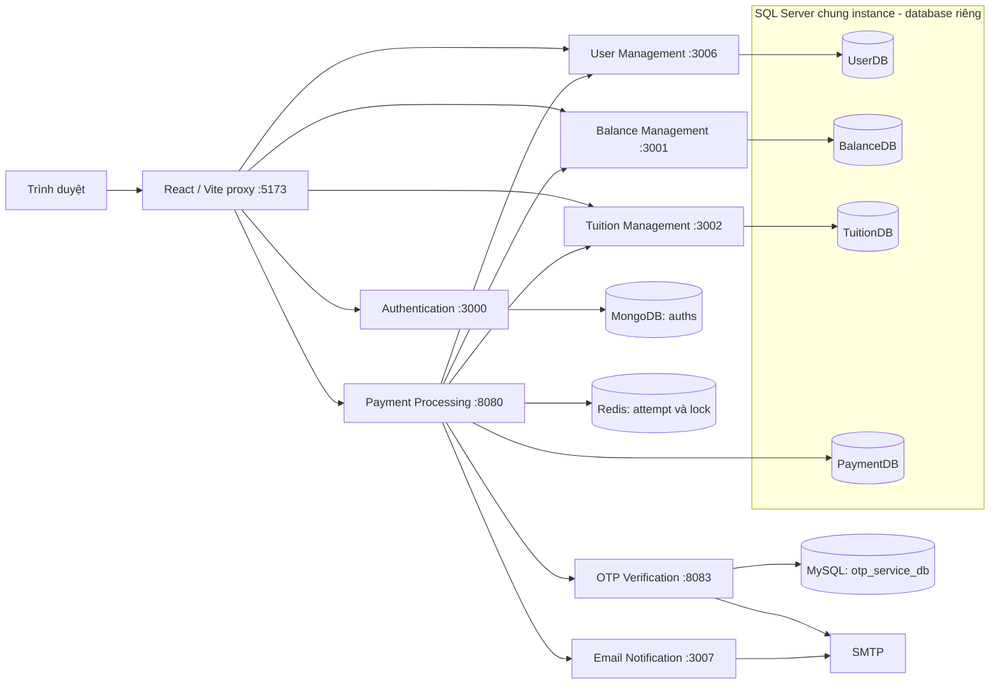
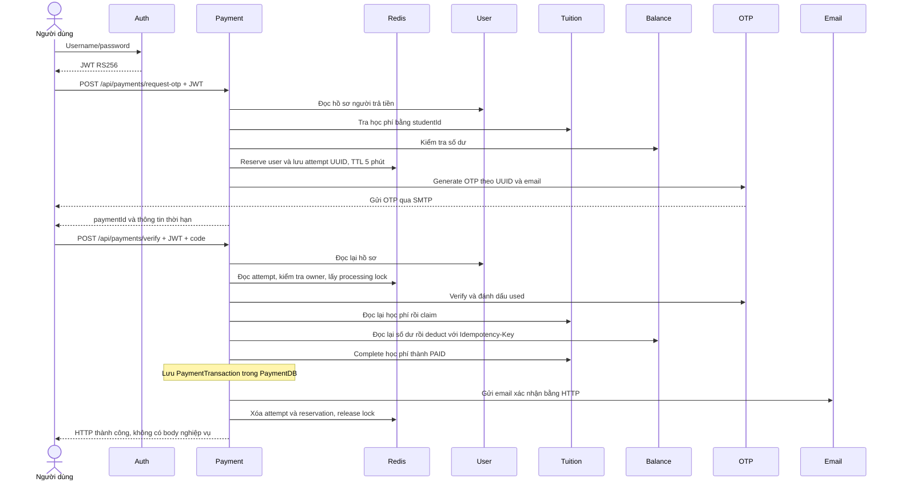

# project — Phân tích và giải thích lựa chọn kiến trúc

## A. Architecture Overview

### A.1. Kiến trúc tổng thể

project tổ chức backend theo kiến trúc **microservices**, phân chia theo trách nhiệm nghiệp vụ. Mỗi service có tiến trình, cấu hình và Dockerfile riêng. Trong các service Java, các lớp controller, service, repository, entity và DTO thể hiện cách phân tầng xử lý HTTP, nghiệp vụ và persistence. Authentication dùng Node.js/Express, được chia thành route, controller, service và Mongoose model.

Giao tiếp giữa các service là REST API qua HTTP đồng bộ. Payment Processing đóng vai trò điều phối luồng thanh toán: gọi User, Tuition, Balance, OTP và Email qua Spring `RestClient`. DTO mang tên `PaymentSuccessfulEvent` được gửi bằng HTTP; tên gọi Event không đồng nghĩa với kiến trúc event-driven.

Sơ đồ phản ánh cấu hình Compose, không biểu diễn nhiều replica hoặc hạ tầng production. `frontend/vite.config.ts` ánh xạ `/gateway/{service}` đến backend; đây là proxy của Vite development server. Các client backend dùng hostname cố định trong mạng Docker.

### A.2. Trách nhiệm và dữ liệu của từng service

| Service / thư mục | Vai trò thực tế | Kho dữ liệu |
|---|---|---|
| Authentication / `Backend/auth-service` | Tìm username, kiểm tra bcrypt password, phát JWT RS256 | MongoDB collection `auths`; seed chọn `payment_system`, runtime theo `MONGO_URL` |
| User Management / `Backend/User` | Đọc hồ sơ người dùng hiện tại qua claim userId | SQL Server `UserDB`, bảng `users` |
| Balance Management / `Backend/balance-management` | Đọc số dư, khấu trừ và lưu kết quả theo idempotency key | SQL Server `BalanceDB`, Balance và BalanceDeduction |
| Tuition Management / `Backend/tuition-management` | Tra cứu học phí, claim, complete và release theo paymentId | SQL Server `TuitionDB`, bảng `tuition` |
| Payment Processing / `Backend/payment-service` | Quản lý attempt, kiểm tra quyền sở hữu, điều phối thanh toán, lưu lịch sử | SQL Server `PaymentDB` và Redis |
| OTP Verification / `Backend/otp-service` | Sinh OTP, gửi mail, kiểm tra mã/thời hạn/sử dụng lại | MySQL `otp_service_db`, bảng `otps` |
| Email Notification / `Backend/email-notification-service` | Nhận yêu cầu HTTP nội bộ để gửi email xác nhận | Không có persistence nghiệp vụ trong source |

Service Email được bổ sung vào phân tích vì là một bước trực tiếp trong luồng thanh toán thực tế. Tên service Compose `payment`, `tuition`, `send-email-service` khác tên container tương ứng `payment-service`, `tuition-management`, `email-notification-service`.

## B. Architecture Decision Rationale

### B.1. Microservices và các tiêu chí lựa chọn

| Tiêu chí | Bằng chứng implementation | Lý do phù hợp và giới hạn |
|---|---|---|
| Separation of Concerns | BalanceService xử lý số dư và khấu trừ; TuitionService quản lý học phí và trạng thái; OTP Service xác thực OTP; PaymentService điều phối thông qua các client. | Phân chia trách nhiệm nghiệp vụ theo từng service, giúp xác định rõ nơi sở hữu các quy tắc nghiệp vụ. Tuy nhiên, PaymentService vẫn phụ thuộc vào API và contract của các service liên quan. |
| Independent Deployment | Các backend có Dockerfile và cấu hình build riêng; Docker Compose khai báo build context riêng cho từng service. | Cho phép build và quản lý từng service riêng biệt. Tuy nhiên, việc triển khai thực tế vẫn được điều phối thông qua Docker Compose và có thể chịu ảnh hưởng từ các dependency chung. |
| Independent Scalability | Các service chạy dưới dạng tiến trình/container riêng; Redis được sử dụng chung cho một số cơ chế quản lý payment attempt và locking. | Kiến trúc cho phép xem xét mở rộng từng service theo nhu cầu tải. Tuy nhiên, cấu hình Compose hiện tại sử dụng container_name và host port cố định, chưa có load balancer hoặc autoscaling; khả năng mở rộng ngang chưa được kiểm chứng thực tế. |
| Database per Service | Các service sử dụng database riêng: SQL Server cho các nghiệp vụ tương ứng, MongoDB cho Authentication và MySQL cho OTP. | Phân định quyền sở hữu dữ liệu ở cấp ứng dụng, hạn chế truy cập trực tiếp vào dữ liệu của service khác. Tuy nhiên, các SQL Server database vẫn dùng chung một instance và credentials; mức độ isolation ở tầng hạ tầng và quyền truy cập database chưa hoàn toàn độc lập. |
| Maintainability | Các service tổ chức controller, service, repository và DTO riêng theo trách nhiệm. | Giúp định vị và thay đổi logic trong phạm vi từng service. Đổi lại, DTO/client có thể bị lặp giữa các service và việc thay đổi API contract đòi hỏi phối hợp giữa các thành phần liên quan. |
| Technology Autonomy | Authentication sử dụng Express/Mongoose; các service backend còn lại chủ yếu sử dụng Spring Boot/JPA; hệ thống sử dụng nhiều hệ quản trị cơ sở dữ liệu. | Cho phép lựa chọn công nghệ phù hợp với từng thành phần. Tuy nhiên, việc duy trì nhiều runtime, driver, phiên bản và quy trình vận hành làm tăng độ phức tạp quản lý hệ thống. |

Với mục tiêu thực hành xây dựng hệ thống thanh toán phân tán, việc lựa chọn Microservices giúp dự án tiếp cận các vấn đề về phân chia trách nhiệm nghiệp vụ, giao tiếp liên tiến trình, quản lý dữ liệu độc lập và phối hợp quy trình thanh toán giữa nhiều service.

### B.2. So sánh các phương án kiến trúc khác

| Phương án | Lợi ích nếu áp dụng | Lý do project lựa chọn phương án hiện tại |
|---|---|---|
| Monolithic | Đơn giản hơn trong triển khai và vận hành; các module có thể gọi trực tiếp thông qua lời gọi hàm nội bộ; dễ quản lý transaction khi dữ liệu cùng nằm trong một database. | project lựa chọn Microservices nhằm thực hành việc phân chia hệ thống thành các tiến trình độc lập, giao tiếp qua REST API và phối hợp dữ liệu giữa nhiều service. Đây là mục tiêu kỹ thuật của đồ án, không phải do Monolithic không đáp ứng được nghiệp vụ. |
| Modular Monolith | Duy trì ranh giới module rõ ràng trong một tiến trình; giảm giao tiếp qua mạng và đơn giản hóa việc kiểm soát dữ liệu, transaction nội bộ. | Source code hiện tại lựa chọn tách các nghiệp vụ thành những service độc lập để thực hành giao tiếp liên tiến trình và quản lý dữ liệu phân tán. Không có bằng chứng cho thấy Modular Monolith không thể đáp ứng các yêu cầu nghiệp vụ của project. |
| Event-driven Microservices | Hỗ trợ xử lý bất đồng bộ, giảm sự phụ thuộc trực tiếp giữa các service và phù hợp với những tác vụ như gửi thông báo hoặc xử lý nền. | project hiện sử dụng giao tiếp HTTP đồng bộ để điều phối quy trình thanh toán và nhận kết quả trực tiếp. Việc bổ sung message broker sẽ cần thêm cơ chế quản lý message delivery, retry, consumer và xử lý message trùng lặp. Những thành phần này chưa nằm trong implementation hiện tại. |
| Shared Database | Cho phép nhiều service truy cập cùng nguồn dữ liệu; thuận tiện khi truy vấn kết hợp, thiết lập FK và quản lý transaction tập trung trong cùng database. | project lựa chọn database riêng theo service để phân định quyền sở hữu dữ liệu. Đổi lại, hệ thống không thể dựa vào FK hoặc transaction database thông thường để đảm bảo quan hệ xuyên service, do đó cần xử lý phối hợp và tính nhất quán thông qua giao tiếp liên service. |

Việc lựa chọn Microservices không đồng nghĩa đây là phương án tối ưu cho mọi hệ thống. Đối với project, lựa chọn này chủ yếu xuất phát từ mục tiêu thực hành kiến trúc phân tán, trong khi Modular Monolith vẫn là một phương án khả thi và có thể đơn giản hơn về chi phí triển khai, vận hành đối với hệ thống có quy mô tương tự.

## C. Technology Selection

### C.1. Công nghệ ứng dụng và giao tiếp

| Công nghệ | Cách dùng được xác minh | Lý do phù hợp — không phải động cơ lịch sử được xác nhận |
|---|---|---|
| Java Spring Boot | Sáu backend Java; Spring MVC, JPA, Validation, transaction, Mail và Resource Server theo từng module | Tích hợp HTTP, persistence và transaction giúp triển khai các nghiệp vụ có kiểm tra trạng thái rõ ràng. Không chứng minh hiệu năng tối ưu chỉ từ framework |
| Node.js / Express | Authentication, Mongoose, bcryptjs và jsonwebtoken | Phù hợp service có luồng tìm tài khoản → kiểm tra mật khẩu → ký token. Đây là technology autonomy thực tế, không có bằng chứng Node nhanh hơn Java trong dự án |
| REST API / HTTP | Payment dùng UserClient, BalanceClient, TuitionClient, OtpClient, EmailClient | JSON/HTTP dễ tích hợp giữa Java và JavaScript, thuận tiện kiểm tra API. Đổi lại là phụ thuộc runtime, độ trễ và khả năng lỗi từng lần gọi |
| JWT RSA / Spring Security | Auth ký RS256; resource server dùng public-key-location | Service xác minh chữ ký mà không cần gọi Auth cho từng request. Không có refresh-token flow, revocation list hoặc cấu hình key rotation trong source đã kiểm tra |
| Docker Compose | Image/build context, network, ports, volumes, seed và depends_on | Mô tả môi trường nhiều service có thể tái tạo cho phát triển/demo. Không thay thế orchestration đa host, HA hay autoscaling |

Các Dockerfile Java dùng build stage JDK/Maven và runtime JRE 21; lệnh package bỏ qua test bằng `-DskipTests`. Điều này giảm phần build tool trong runtime image, nhưng build image thành công không chứng minh test thành công. Auth Dockerfile dùng Node 24 Alpine; manifest có khai báo runtime dependency khác, nên không thể khẳng định toàn repository thống nhất phiên bản Node. Các `pom.xml` cũng dùng nhiều phiên bản Spring Boot, làm tăng nhu cầu kiểm tra tương thích.

### C.2. Công nghệ lưu trữ

| Công nghệ | Implementation | Lý do phù hợp và trade-off |
|---|---|---|
| SQL Server | UserDB, BalanceDB, TuitionDB, PaymentDB; JPA entity và seed SQL | Dữ liệu người dùng, tiền và trạng thái có cấu trúc; Balance/Tuition cần local transaction và locking. Dùng chung instance tạo điểm lỗi/tài nguyên chung |
| MySQL | OTP có PK, unique payment_id, index expires_at/used; schema init từ classpath | Đáp ứng lưu OTP có cấu trúc và atomic conditional UPDATE. Không có đặc điểm trong source chứng minh chỉ MySQL mới đáp ứng được |
| MongoDB | Auth schema gồm userId, username, password; Mongoose | Document model tích hợp trực tiếp với Node.js. Schema hiện nhỏ; không có bằng chứng nhu cầu dữ liệu phi cấu trúc, sharding hoặc lợi ích hiệu năng so với SQL |
| Redis | JSON PaymentAttempt, reservation và processing lock với TTL | Phù hợp dữ liệu ngắn hạn và thao tác SETNX chia sẻ giữa tiến trình. Compose không cấu hình volume riêng cho Redis, replication hoặc failover; attempt không phải sổ giao dịch bền vững |

Việc dùng nhiều engine là polyglot persistence đã triển khai. Lợi ích tách lựa chọn theo service đi kèm chi phí backup, khôi phục, giám sát và hiểu nhiều mô hình dữ liệu. Không có benchmark để chứng minh bốn engine là số lượng cần thiết.

SQL Server dùng `ddl-auto=update`; OTP dùng `ddl-auto=none` và SQL init. Đây chưa phải hệ thống migration có version thống nhất. Schema OTP classpath khai báo email dài 100, trong khi entity và seed MySQL khai báo 150; seed MySQL không được mount trong Compose. Các kết luận về schema instance phải xét lịch sử volume.

## D. Payment Workflow Architecture

### D.1. Trình tự được triển khai

Sơ đồ thể hiện nhánh thành công; các nhánh lỗi được phân tích tại mục E.

1. **Authentication:** `auth.service.js/login()` tìm tài khoản theo username, dùng bcrypt.compare và phát token chứa userId/username. API phía sau lấy danh tính từ token, không nhận userId người trả tiền do client tự chọn.
2. **Request OTP:** `PaymentController.requestOtp()` kiểm tra payload và điều khoản, gọi UserClient để lấy email. `PaymentService.requestOtp()` tra Tuition theo studentId, yêu cầu UNPAID và số dư đủ. Số tiền lấy từ TuitionResponse, không lấy số tiền client gửi. Service tạo UUID và lưu PaymentAttempt trước khi gọi OTP.
3. **OTP Verification:** controller đọc lại hồ sơ; `verifyOtpAndPay()` đọc attempt, so owner với JWT userId và lấy lock theo user. OtpClient gửi paymentId/code; OTP service xác thực trước khi tiếp tục thao tác ví/học phí.
4. **Balance Validation:** sau OTP, Payment đọc lại học phí, kiểm tra UNPAID và claim bằng paymentId. Sau đó đọc lại số dư; BalanceService tiếp tục kiểm tra số tiền và số dư trong chính transaction khấu trừ. Kiểm tra trước OTP không thay thế kiểm tra tại thời điểm ghi.
5. **Balance Deduction:** BalanceClient gửi paymentId qua `Idempotency-Key`. BalanceService khóa ví, tìm deduction cũ; nếu chưa có thì giảm số dư và ghi BalanceDeduction trong local transaction.
6. **Tuition Status Update:** TuitionClient gọi complete theo studentId/paymentId. Conditional UPDATE chỉ hoàn tất khi trạng thái PROCESSING và UUID trùng claim; chuyển thành PAID, xóa processingPaymentId.
7. **Payment Result:** PaymentTransactionService lưu userId, tuitionId, amount, status PAID và thời điểm. Payment gọi EmailClient đồng bộ rồi xóa attempt. Controller verify trả `void`, nên nhánh hoàn tất trả HTTP thành công với body rỗng; lịch sử đọc qua API riêng.

### D.2. Ý nghĩa của điều phối tập trung

PaymentService tập hợp thứ tự nghiệp vụ trong một chỗ, trong khi Balance và Tuition vẫn tự kiểm tra tính hợp lệ khi ghi dữ liệu. Cách tổ chức này giúp đọc được luồng thanh toán và hạn chế việc frontend quyết định kết quả. Đổi lại, Payment phụ thuộc đồng thời vào khả năng phục vụ của nhiều thành phần; lỗi email ở cuối cũng làm request thanh toán báo lỗi dù tiền/học phí đã cập nhật.

PaymentAttempt có amount snapshot nhưng nhánh verify dùng amount đọc lại từ TuitionResponse, không so sánh với attempt.amount. Vì vậy, source chưa bảo đảm số tiền đã được OTP xác nhận giữ nguyên nếu học phí đổi giữa hai bước. Source cũng không nối User.studentId dạng String với Tuition.studentId dạng Long; không được suy ra người trả tiền luôn là sinh viên của khoản học phí.

## E. Security and Data Consistency

### E.1. Xác thực và ranh giới tin cậy

Auth giữ đường dẫn private key để ký RS256. Các resource server User, Balance, Tuition và Payment cấu hình public key để kiểm tra JWT; SecurityConfig yêu cầu authenticated cho các request ngoài đường dẫn health được permit. Không thấy role-based authorization, custom issuer/audience policy hoặc kiểm tra quan hệ người trả tiền–sinh viên. JWT được ký, không phải dữ liệu được mã hóa.

Compose sinh cặp RSA 2048 bit khi file key còn thiếu. Tuy nhiên, các service Java được mount cả thư mục `keys` ở chế độ read-only, nên việc chỉ cấu hình public key không đồng nghĩa private key đã được cách ly filesystem khỏi chúng. Compose không khai báo TLS termination cho HTTP giữa service; RSA signature bảo vệ tính xác thực token, không cung cấp mã hóa đường truyền.

Payment chuyển tiếp Authorization đến User/Balance/Tuition. OTP và Email dùng `X-Internal-Service-Token`: OTP qua InternalTokenFilter, Email qua kiểm tra trong controller. OtpClient hiện dùng token cố định trong source, còn OTP kiểm tra biến môi trường; cần bảo đảm hai phía khớp trước khi chạy, không thể coi cấu hình hiện tại chắc chắn hoạt động xuyên suốt. Không ghi giá trị token hoặc bí mật vào tài liệu.

Các API ghi số dư/trạng thái học phí sử dụng JWT authentication; source không thể hiện policy chỉ cho phép Payment Service gọi các API đó. Vì vậy, không suy diễn rằng mọi mutation đã bị buộc phải đi qua OTP bằng phân quyền service-to-service. CORS và việc tắt CSRF trong SecurityConfig không thay thế kiểm soát quyền nghiệp vụ.

### E.2. OTP: điều kiện nguyên tử và giới hạn thực tế

OtpService sinh mã bằng SecureRandom, mặc định hiệu lực 5 phút và max attempts 5. OtpRepository xác minh bằng một UPDATE có điều kiện: đúng paymentId/code, chưa used, chưa hết hạn và attempts còn dưới ngưỡng. Thành công đánh dấu used trong transaction riêng của OTP, giúp chống hai lần verify cùng mã ở database.

Tuy nhiên, `verifyOtp()` tăng attempts rồi ném RuntimeException khi đạt max. Với transaction mặc định, nhánh này có thể rollback lần tăng cuối, khiến cơ chế khóa sau đúng 5 lần không đạt kỳ vọng. Tài liệu không khẳng định giới hạn thử sai đã hoạt động hoàn chỉnh chỉ từ cấu hình max-attempts. Code OTP được lưu trực tiếp trong cột code, không có hash OTP trong entity/service.

Generate lại cùng paymentId cập nhật bản ghi cũ, reset used/attempts. Gửi SMTP nằm trong method transactional: lỗi gửi có thể rollback thay đổi MySQL, nhưng việc gửi email bên ngoài không thể rollback theo database. OTP được dùng trước khi khấu trừ; nếu bước sau lỗi, source không hoàn nguyên used để retry cùng mã. Scheduler chỉ xóa bản ghi hết hạn trước ngưỡng now−24 giờ.

### E.3. Concurrency và duplicate payment

| Cơ chế | Implementation | Phạm vi bảo đảm / giới hạn |
|---|---|---|
| Redis active reservation | SETNX `payment-active:{userId}`, TTL 5 phút | Giới hạn attempt hoạt động theo người dùng trong thời hạn key; ghi reservation và attempt là hai thao tác, không phải một transaction Redis nguyên tử |
| Redis processing lock | SETNX `payment-processing:{userId}`, TTL 5 phút | Là distributed lock đơn giản trên Redis chung. Không có lease renewal, fencing token hoặc Redlock; xử lý lâu hơn TTL có thể mất loại trừ |
| Release có kiểm tra owner | Lua GET so paymentId rồi DEL | Tránh xóa key có value khác. Value dùng cùng paymentId nên không phải token duy nhất cho mỗi lần acquire; không khẳng định xử lý mọi trường hợp reacquire sau hết lease |
| Pessimistic locking | BalanceRepository và TuitionRepository dùng PESSIMISTIC_WRITE | Khóa trong local transaction; khóa đọc Tuition không kéo dài qua các HTTP call của Payment |
| Conditional tuition claim | UPDATE UNPAID → PROCESSING, gắn paymentId | Phân xử nhiều người trả cùng học phí tại DB; complete/release phải trùng paymentId |
| Idempotent balance deduction | Unique payment_id và lưu amount/userId/balance_after | Cùng UUID + cùng payload trả kết quả đã lưu; khác user/amount bị từ chối. Local transaction gắn giảm ví và ghi deduction |

Redis lock theo user không đủ ngăn hai người khác nhau trả cùng học phí; claim tại Tuition là lớp bảo vệ bổ sung. Ngược lại, unique payment_id chỉ chống lặp cùng UUID, không tự chống một khoản học phí bị gửi dưới nhiều UUID. `balance.user_id` và `tuition.student_id` không có unique trong mapping/seed; repository trả Optional không tạo constraint, nên các cơ chế trên dựa vào kỳ vọng dữ liệu không trùng.

Không gọi toàn bộ API thanh toán là idempotent: OTP dùng một lần, attempt hết TTL và lịch sử không lưu UUID paymentId. PaymentTransaction.id là BIGINT tự tăng; không có unique tuition_id hoặc liên kết bền vững theo UUID để nối chính xác lịch sử với deduction/OTP.

### E.4. Lỗi, local rollback và giải phóng claim

`PaymentService` không bao bọc toàn bộ quy trình bằng một transaction chung. BalanceService và TuitionService có local transaction riêng; OtpService có transaction MySQL riêng. Các commit đã thành công không rollback khi một HTTP call sau đó thất bại.

| Điểm lỗi | Hành vi theo source | Hệ quả |
|---|---|---|
| Generate OTP lỗi sau khi saveAttempt | Không có catch xóa attempt ở requestOtp | Reservation có thể còn đến TTL, người dùng chưa tạo attempt mới ngay được |
| OTP thành công, lỗi trước claim | OTP đã used; chưa có claim để release | Không thể mặc định dùng lại cùng OTP |
| Claim xong, lỗi khi đọc/kiểm tra số dư trước deduct | `safeToReleaseClaim=true`; catch gọi release | Giải phóng học phí về UNPAID nếu release thành công; lỗi release được thêm suppressed exception |
| Đã bắt đầu gọi deduct, bao gồm timeout hoặc lỗi phản hồi | Cờ safeToReleaseClaim đã false | Giữ claim vì chưa biết tiền đã trừ hay chưa; không có tự động refund hoặc job đối soát |
| Đã trừ tiền, complete Tuition lỗi | Không hoàn tiền, không rollback BalanceDB | Có thể ví đã giảm và Tuition còn PROCESSING |
| Tuition PAID nhưng lưu lịch sử lỗi | Không hoàn nguyên Tuition/Balance | Có thể thiếu PaymentTransaction dù nghiệp vụ đã ghi nhận thanh toán |
| Lưu lịch sử xong nhưng gửi email hoặc xóa attempt lỗi | Exception truyền về; không rollback tiền/học phí/lịch sử | Người dùng nhận lỗi dù thanh toán có thể đã hoàn tất |

`finally` cố release processing lock; lỗi Redis tại bước này cũng có thể làm request lỗi. Claim không có TTL trong database; Redis hết hạn không tự giải phóng học phí PROCESSING. Không thấy retry worker, outbox, durable workflow state machine hay automatic reconciliation.

Do đó, cách gọi chính xác là **điều phối HTTP đồng bộ, local transaction và giải phóng claim có điều kiện**. Source chưa triển khai Distributed Transaction/2PC hoặc một Saga đầy đủ. Thao tác release có tác dụng bù cục bộ trước khi khấu trừ, không đủ để khẳng định mọi bước đều có compensation và phục hồi sau crash.

Global exception handlers chuẩn hóa một số lỗi business/validation, ẩn chi tiết nội bộ; OtpClient chuyển lỗi authorization nội bộ thành lỗi dependency. Tuy nhiên, RestClientConfig chỉ tạo builder mặc định, không thấy policy timeout HTTP riêng, retry hoặc circuit breaker. Timeout Hikari/SMTP trong OTP là cấu hình cho các kết nối đó, không phải timeout cho toàn bộ workflow.

## F. Architecture Trade-offs

| Khía cạnh | Ưu điểm của cách triển khai hiện tại | Chi phí/hạn chế so với monolithic |
|---|---|---|
| Tổ chức nghiệp vụ | Ranh giới Auth, ví, học phí, OTP rõ | Phải duy trì nhiều API/DTO và version contract |
| Dữ liệu | Mỗi service quản lý persistence riêng | Không có FK/transaction xuyên database; đối soát khó hơn |
| Triển khai | Build artifact/container riêng | Nhiều image, cấu hình, secret, seed và thứ tự khởi động |
| Đồng thời | Kết hợp Redis, DB lock, conditional UPDATE, idempotency | Khó suy luận trạng thái sau timeout/crash; lease và claim có vòng đời khác nhau |
| Khả dụng | Một số chức năng đọc có thể chạy khi service khác lỗi | Checkout phụ thuộc dây chuyền nhiều service và SMTP; chưa có isolation bằng queue/circuit breaker |
| Tài nguyên | Có cơ sở để phân bổ theo service trong tương lai | Nhiều JVM/DB engine; chưa có đo đạc hoặc cơ chế scale production |
| Bảo trì | Dễ định vị logic trong từng module | Debug xuyên HTTP cần correlation và tracing; source chưa có hệ thống distributed tracing/metrics tập trung |
| Vận hành dữ liệu | Volumes cho MongoDB, MySQL, SQL Server | Backup/restore phối hợp, phục hồi Redis/claim và dữ liệu lệch chưa được tự động hóa |

Compose healthcheck cho SQL Server/MySQL và tác vụ seed/key giúp thứ tự startup rõ hơn. `depends_on: service_started` ở một số dependency chỉ xác nhận tiến trình đã bắt đầu, không bảo đảm mọi API/SMTP đã sẵn sàng. Các database và backend được publish cổng host; network bridge không tự tạo ranh giới truy cập production.

Đối với một nhóm nhỏ và lưu lượng thấp, monolithic có thể giảm đáng kể chi phí này, đặc biệt khi cần atomicity ví–học phí–lịch sử. Microservices hiện tại phù hợp hơn với mục tiêu phân tách và thực hành tích hợp của đồ án; độ phức tạp bổ sung cần được thừa nhận thay vì xem là lợi ích mặc định.

## G. Conclusion

Kiến trúc project phù hợp để minh họa hệ thống thanh toán học phí theo microservices: trách nhiệm được chia theo nghiệp vụ, dữ liệu do service sở hữu, REST kết nối nhiều runtime, Payment điều phối và các service dữ liệu tự kiểm soát ghi đồng thời. JWT RS256, OTP có điều kiện, Redis reservation/lock, pessimistic locking và idempotency tại Balance là các cơ chế có bằng chứng triển khai cụ thể.

Mức hoàn thiện hiện tại phù hợp cho phân tích và demo đồ án, chưa đủ căn cứ khẳng định tính sẵn sàng production hoặc nhất quán xuyên service. Các giới hạn quan trọng là kết quả thanh toán không nguyên tử, phục hồi sau lỗi chưa tự động, lịch sử thiếu UUID để đối soát, cấu hình internal token chưa thống nhất và giới hạn OTP cần kiểm chứng. Kết luận về tính phù hợp phải đi cùng các giới hạn này; không có bằng chứng cho rằng monolithic không thể đáp ứng cùng nghiệp vụ.

## Nguồn đối chiếu

- [README hiện có](../../README.md), [Docker Compose](../../docker-compose.yml), [Vite proxy](../../frontend/vite.config.ts).
- [Auth service](../../Backend/auth-service/src/services/auth.service.js), [Auth model](../../Backend/auth-service/models/auth.model.js), [Auth manifest](../../Backend/auth-service/package.json).
- [UserService](../../Backend/User/src/main/java/com/MyProject/User/service/UserService.java), [User SecurityConfig](../../Backend/User/src/main/java/com/MyProject/User/config/SecurityConfig.java).
- [PaymentController](../../Backend/payment-service/src/main/java/com/myproject/payment/controller/PaymentController.java), [PaymentService](../../Backend/payment-service/src/main/java/com/myproject/payment/service/PaymentService.java), [PaymentAttemptService](../../Backend/payment-service/src/main/java/com/myproject/payment/service/PaymentAttemptService.java).
- [PaymentTransactionService](../../Backend/payment-service/src/main/java/com/myproject/payment/service/PaymentTransactionService.java), [PaymentTransaction](../../Backend/payment-service/src/main/java/com/myproject/payment/entity/PaymentTransaction.java), [RestClientConfig](../../Backend/payment-service/src/main/java/com/myproject/payment/config/RestClientConfig.java), [OtpClient](../../Backend/payment-service/src/main/java/com/myproject/payment/client/OtpClient.java).
- [BalanceService](../../Backend/balance-management/src/main/java/com/myproject/balance/service/BalanceService.java), [BalanceRepository](../../Backend/balance-management/src/main/java/com/myproject/balance/repository/BalanceRepository.java), [BalanceDeduction](../../Backend/balance-management/src/main/java/com/myproject/balance/entity/BalanceDeduction.java).
- [TuitionService](../../Backend/tuition-management/src/main/java/com/myproject/tuition/service/TuitionService.java), [TuitionRepository](../../Backend/tuition-management/src/main/java/com/myproject/tuition/repository/TuitionRepository.java).
- [OtpService](../../Backend/otp-service/src/main/java/com/paymentsystem/otpservice/service/OtpService.java), [OtpRepository](../../Backend/otp-service/src/main/java/com/paymentsystem/otpservice/repository/OtpRepository.java), [InternalTokenFilter](../../Backend/otp-service/src/main/java/com/paymentsystem/otpservice/security/InternalTokenFilter.java), [OTP configuration](../../Backend/otp-service/src/main/resources/application.yml), [OTP schema](../../Backend/otp-service/src/main/resources/db/schema.sql).
- [EmailController](../../Backend/email-notification-service/src/main/java/com/myproject/emailnotification/controller/EmailController.java).